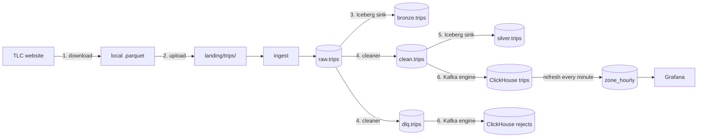

# Following a file through the pipeline

This walks one month of NYC taxi trips from the TLC website to the Grafana dashboard, checking
the row counts at every stage. The example uses September 2026; any month works.



The number to follow is the file's row count, **N**. Every row should end up in exactly one place:

| Stage | Should hold | September 2026 |
|---|---|---|
| The downloaded file | N rows | 3,876,044 |
| `raw.trips`, `bronze.trips` | N rows (more only if ingest restarted mid-file; the extras are duplicates) | 3,876,044 |
| `clean.trips`, `silver.trips`, ClickHouse `trips` | N minus the rejects | 3,861,192 |
| `dlq.trips`, ClickHouse `rejects` | the rejects, normally about 0.4% of N | 14,852 (0.38%) |
| gold `zone_hourly` | the same total as silver, grouped by zone and hour | 3,861,170 in September (22 pickups are dated outside it) |

The whole run takes about three minutes: ingest needs seconds, the cleaner under a minute, and the
Iceberg sinks a minute or two.

## Before you start

The cluster must be running (start Docker Desktop first if it isn't), with every ArgoCD app
Synced and Healthy:

```bash
k3d cluster start xenny
```

```bash
kubectl -n argocd get applications
```

In one terminal, open the port-forwards and leave them running:

```bash
tools/ports.sh s3 lakekeeper connect clickhouse grafana
```

In a second terminal, at the repo root, set up the variables and two helpers used below:

```bash
export MONTH=2026-09
export FILE=trips/yellow_tripdata_$MONTH.parquet
export LOCAL=~/Downloads/yellow_tripdata_$MONTH.parquet
export AWS_ACCESS_KEY_ID=$(kubectl -n pipelines get secret s3-credentials -o jsonpath='{.data.AWS_ACCESS_KEY_ID}' | base64 -d)
export AWS_SECRET_ACCESS_KEY=$(kubectl -n pipelines get secret s3-credentials -o jsonpath='{.data.AWS_SECRET_ACCESS_KEY}' | base64 -d)
export CH_PASSWORD=$(kubectl -n warehouse get secret clickhouse-users -o jsonpath='{.data.grafana}' | base64 -d)
# Runs a Kafka CLI tool inside a broker pod, e.g. kafka kafka-topics --list
kafka() { kubectl -n kafka exec xenny-dual-0 -c kafka -- "bin/$1.sh" --bootstrap-server localhost:9092 "${@:2}"; }
# Runs a read-only ClickHouse query, e.g. ch "SELECT 1"
ch() { curl -sS -u "grafana:$CH_PASSWORD" http://localhost:8123/ --data-binary "$1 FORMAT PrettyCompact"; }
```

Record the "before" numbers, so you can tell this file's rows from the ones already there:

```bash
kafka kafka-get-offsets --topic raw.trips | awk -F: '{s+=$3} END {print "raw.trips records:", s}'
```

## 1. Pull the data

Download the month from the [TLC trip record page](https://www.nyc.gov/site/tlc/about/tlc-trip-record-data.page)
(files appear about two months after the month ends):

```bash
curl -fL -o "$LOCAL" "https://d37ci6vzurychx.cloudfront.net/trip-data/yellow_tripdata_$MONTH.parquet"
```

**Check it.** Count the rows and look at the date range. This count is **N**:

```bash
duckdb -c "SELECT count(*) AS n, min(tpep_pickup_datetime) AS first_pickup, max(tpep_pickup_datetime) AS last_pickup FROM '$LOCAL'"
```

A few pickups usually fall outside the month (clock errors in the meters); that's normal.
`sql/explore.sql` digs into what else is odd in the data and why the cleaner's rules are what they are.

## 2. Load it (landing → ingest → raw.trips)

Upload the file to the landing bucket. The ingest service checks the folder every 10 seconds:

```bash
aws --endpoint-url http://localhost:8333 s3 cp "$LOCAL" "s3://landing/$FILE"
```

**Check it.**

- Ingest logs `Ingesting trips/...`, then `Ingested trips/...: N rows` once Kafka has acknowledged
  every row (about 10 seconds for a month):

  ```bash
  kubectl -n pipelines logs deploy/trips-ingest --since=10m | grep "$MONTH"
  ```

- The file moved to `processed/`. A file in `failed/` couldn't be read, or reused the name of a file
  that was already ingested with different contents; the log says which.

  ```bash
  aws --endpoint-url http://localhost:8333 s3 ls --recursive s3://landing/ | grep "$MONTH"
  ```

- `raw.trips` grew by exactly N. Run the offsets command from "Before you start" again and subtract.
- The ingest ledger lists the file, so dropping it again is a no-op:

  ```bash
  kafka kafka-console-consumer --topic ingest.ledger --from-beginning --timeout-ms 5000 \
    --formatter-property print.key=true --formatter-property print.value=false 2>/dev/null
  ```

## 3. Bronze (raw.trips → Iceberg)

The `bronze-trips` Kafka Connect sink copies every `raw.trips` record into the Iceberg table
`bronze.trips`, committing a new snapshot every 60 seconds.

**Check it.**

- The connector and its task are `RUNNING`, and its consumer group has caught up (`LAG` 0).
  The sink saves its Kafka position only when it commits to Iceberg, so `LAG` stays at the full
  file size for a minute or two, then drops to 0 in one go. Until then, bronze shows 0 rows for the file.

  ```bash
  curl -s localhost:8083/connectors/bronze-trips/status
  ```

  ```bash
  kafka kafka-consumer-groups --describe --group connect-bronze-trips
  ```

- Bronze holds the file's rows. `unique_rows` should equal N; `rows` is higher only if ingest
  produced duplicates:

  ```bash
  duckdb -init sql/lake.sql -c "SELECT count(*) AS rows, count(DISTINCT row_number) AS unique_rows FROM lake.bronze.trips WHERE source_file = '$FILE'"
  ```

## 4. Clean (raw.trips → cleaner → clean.trips and dlq.trips)

The cleaner (Kafka Streams) drops duplicate rows, looks up the zone names, and checks four rules
(see [Cleaner.java](../apps/cleaner/src/main/java/xenny/cleaner/Cleaner.java)):

| Rule | Rejects a trip when |
|---|---|
| `reversal` | the fare or total is negative (a refund or void of an earlier trip) |
| `bad_duration` | dropoff is before pickup, or the trip lasts over a day |
| `bad_distance` | the distance is negative or over 100 miles |
| `unknown_zone` | a location ID isn't in the zone lookup |

Valid trips go to `clean.trips`; rejects go to `dlq.trips` unchanged, with a `rule` header.

**Check it.**

- The cleaner has caught up (`LAG` 0 on every partition):

  ```bash
  kafka kafka-consumer-groups --describe --group trips-cleaner
  ```

- Its counters (since the pod started) show how many trips it passed and rejected, by rule:

  ```bash
  POD=$(kubectl -n pipelines get pod -l app=trips-cleaner -o jsonpath='{.items[0].metadata.name}')
  kubectl get --raw "/api/v1/namespaces/pipelines/pods/$POD:8080/proxy/metrics" | grep '^trips_'
  ```

- Rejects carry their rule. This shows the header (`rule:reversal`) and key (`file:row`) of the
  first few DLQ records, which are from the oldest file:

  ```bash
  kafka kafka-console-consumer --topic dlq.trips --from-beginning --max-messages 5 \
    --formatter-property print.key=true --formatter-property print.headers=true \
    --formatter-property print.value=false 2>/dev/null
  ```

The "Xenny pipelines" dashboard in Grafana (http://localhost:3000) shows the same counts over
time, with consumer lag for every group.

## 5. Silver (clean.trips → Iceberg)

The `silver-trips` sink copies `clean.trips` into `silver.trips`, the same way bronze is filled.

**Check it.**

- The connector is `RUNNING` and caught up:

  ```bash
  curl -s localhost:8083/connectors/silver-trips/status
  ```

  ```bash
  kafka kafka-consumer-groups --describe --group connect-silver-trips
  ```

  A `LAG` of 1 per partition here is normal: the cleaner writes in transactions, and each
  transaction's commit marker takes an offset that no consumer ever reads.

- Silver holds the valid trips, and every one has its zone names:

  ```bash
  duckdb -init sql/lake.sql -c "SELECT count(*) AS rows, count(*) FILTER (WHERE pickup_zone IS NULL OR dropoff_zone IS NULL) AS missing_zones FROM lake.silver.trips WHERE source_file = '$FILE'"
  ```

  `missing_zones` should be 0. Silver rows plus this file's rejects (next step) should equal N.

## 6. ClickHouse and gold

ClickHouse reads `clean.trips` into `trips.trips` and `dlq.trips` into `trips.rejects`, and
recomputes the gold table `trips.zone_hourly` from them every minute
(see [clickhouse.yaml](../pipelines/trips/clickhouse.yaml)). You can run these queries in the
browser at http://localhost:8123/play too (user `grafana`, password `$CH_PASSWORD`).

**Check it.**

- The file's trips and rejects. `FINAL` merges any record Kafka delivered twice:

  ```bash
  ch "SELECT count() AS trips FROM trips.trips FINAL WHERE source_file = '$FILE'"
  ```

  ```bash
  ch "SELECT rule, count() AS rejects FROM trips.rejects FINAL WHERE source_file = '$FILE' GROUP BY rule"
  ```

  `trips` should equal the silver count, and `trips` plus the rejects should equal N.

- The gold table has refreshed since the file landed, and has trips for the month:

  ```bash
  ch "SELECT status, last_success_time FROM system.view_refreshes WHERE view = 'zone_hourly'"
  ```

  ```bash
  ch "SELECT sum(trips) AS trips, round(sum(revenue)) AS revenue FROM trips.zone_hourly WHERE hour >= toDate('$MONTH-01') AND hour < toDate('$MONTH-01') + INTERVAL 1 MONTH"
  ```

  This is close to the file's count but not equal: gold groups by pickup time, and a few of each
  file's pickups fall outside its month.

- Open the "NYC taxi trips" dashboard in Grafana and set the time range to the month: trips per
  hour, the top pickup zones, and average fares.

## 7. Check everything at once

`tools/reconcile.sh` repeats all of the checks above for every file ingested so far:

```bash
tools/reconcile.sh
```

Each file gets one row; `ok` is true when file rows = unique bronze rows = silver + DLQ, and
ClickHouse matches silver. Below the table, the gold total is compared with silver's. The script
ends with `PASS`, or fails with a non-zero exit code if anything doesn't add up.

## When a number doesn't match

| Symptom | Likely cause | Look at |
|---|---|---|
| The file is still in `landing/trips/` | Ingest is down, or still working on an earlier file | `kubectl -n pipelines logs deploy/trips-ingest` |
| The file is in `failed/trips/` | The file is unreadable, or its name was already ingested with other contents | the ingest log line for the file |
| `raw.trips` grew by more than N | Ingest restarted mid-file and resent rows | Expected; the cleaner drops them (`bronze_dups` in the reconcile table) |
| Bronze or silver is short | The sink hasn't committed yet (wait a minute), or its task failed | the connector's `/status`; a failed task includes its stack trace |
| Cleaner lag doesn't fall | The cleaner is down or crash-looping | `kubectl -n pipelines logs deploy/trips-cleaner` |
| Many more rejects than usual | A bad file, or a rule that's too strict | rejects by rule in ClickHouse; the TripsRejectRateHigh alert fires above 5% |
| ClickHouse is short | Its Kafka consumer is failing | `ch "SELECT table, last_poll_time, exceptions.time[-1] AS last_error_time, exceptions.text[-1] AS last_error FROM system.kafka_consumers"`. An error older than `last_poll_time` is stale: it's from before the consumer recovered (e.g. while Docker was stopped) |
| Gold is stale | The refresh failed | `ch "SELECT view, status, exception FROM system.view_refreshes"` |

To push a file through again (after fixing a rule, for example), see
[Replaying files](../README.md#replaying-files) in the README.
